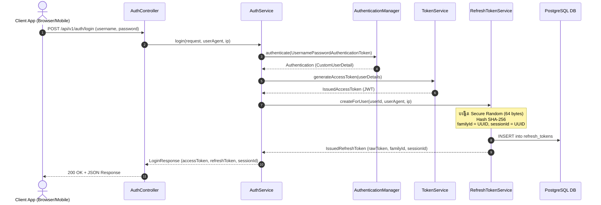
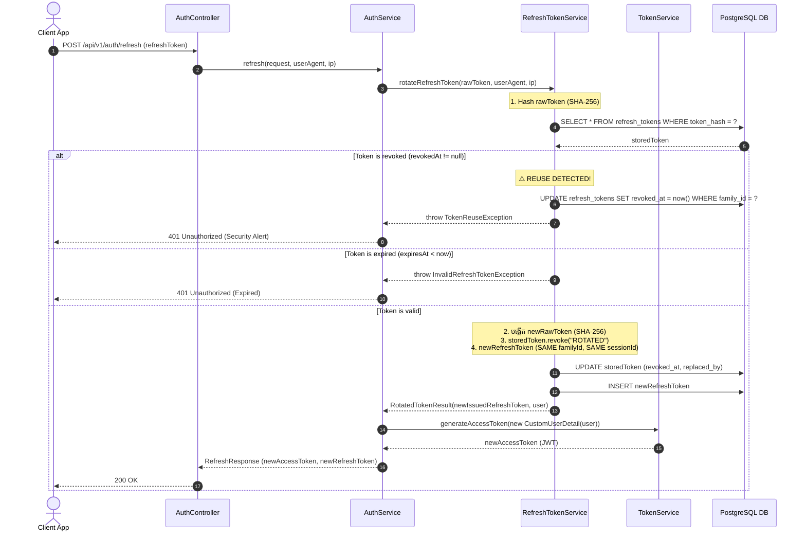
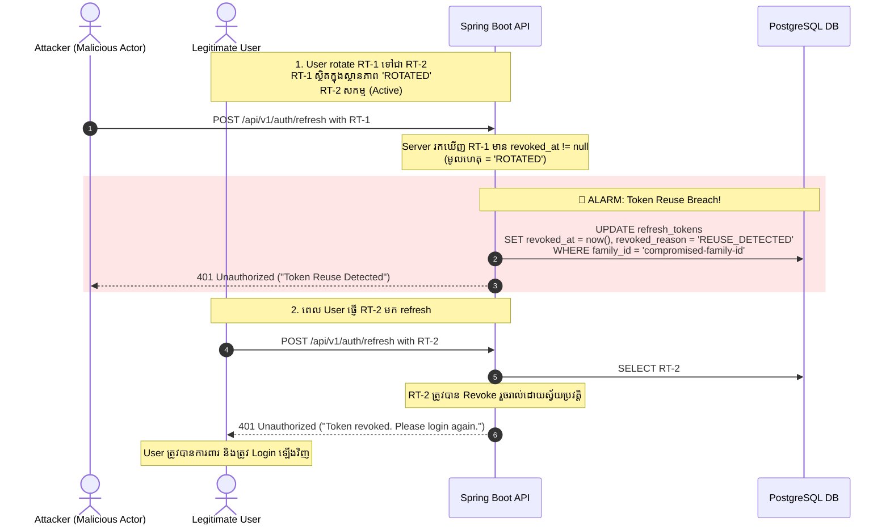
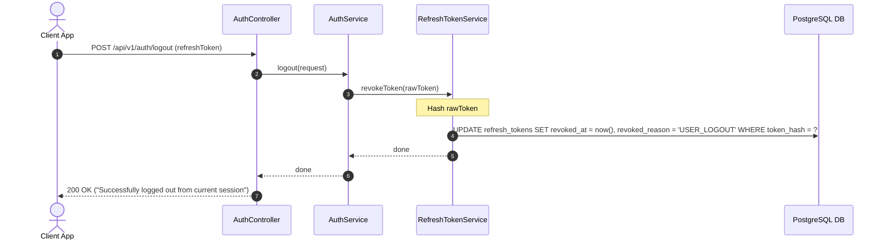
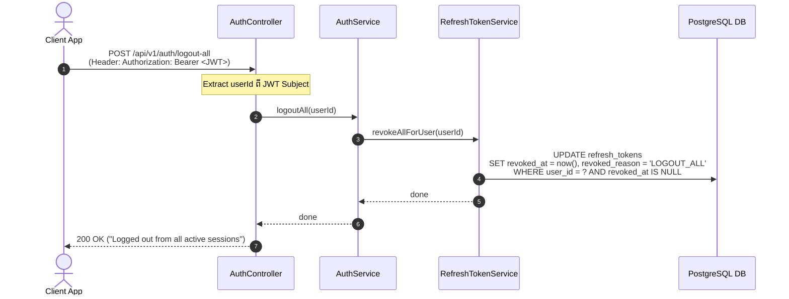
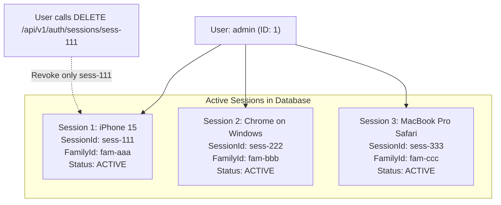

# Lesson 08: Architecture & Sequence Flows
## គំនូសតាងស្ថាបត្យកម្ម និងលំហូរការងារ (Architecture & Diagrams)

---

### 1. លំហូរ Login ដំបូង និងការបង្កើត Session (Initial Login Flow)

---

### 2. លំហូរ Refresh Token Rotation (RTR Flow)

រាល់ពេល Access Token ផុតកំណត់ Client ផ្ញើ Refresh Token ដើម្បីប្តូរយក Token ថ្មីទាំងពីរ៖

---

### 3. លំហូរ Token Reuse Detection (ការចាប់ការលួចប្រើ Token ចាស់)

សេណារីយ៉ូ៖ Hacker លួចបាន Refresh Token $RT_1$ ដែល Client ធ្លាប់បានប្រើដើម្បី Rotate ទៅ $RT_2$ រួចហើយ៖

---

### 4. លំហូរ Logout Current Session

---

### 5. លំហូរ Logout All Sessions (Global Logout)

---

### 6. Multiple Device Session Management

